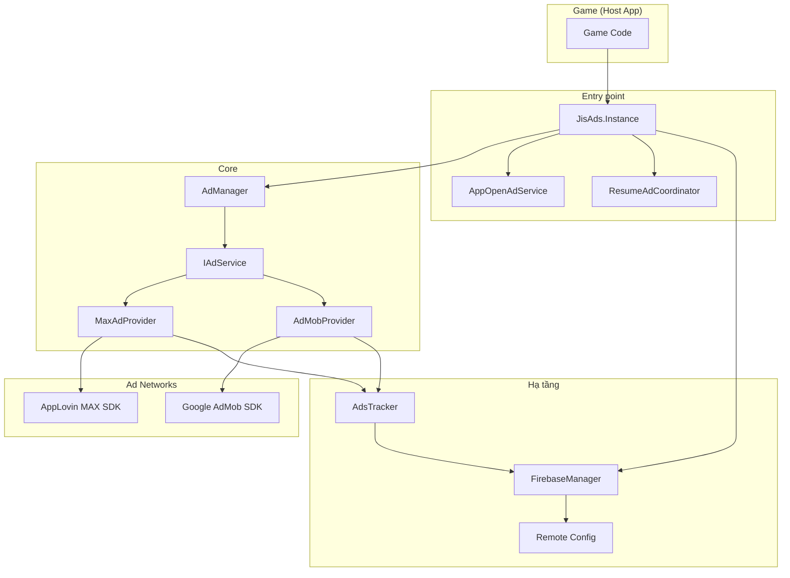
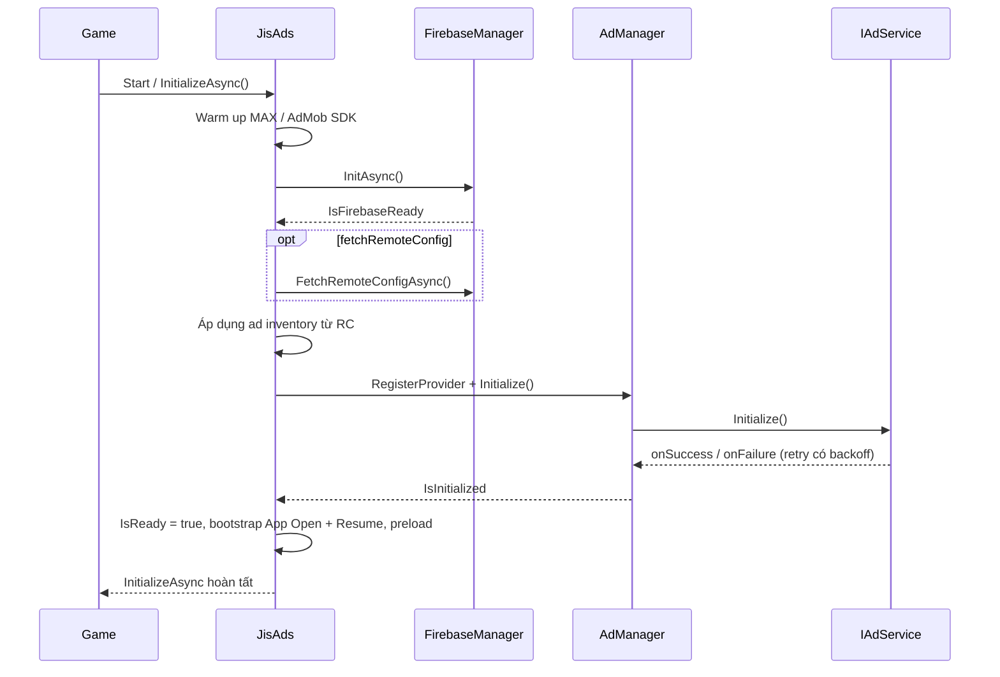
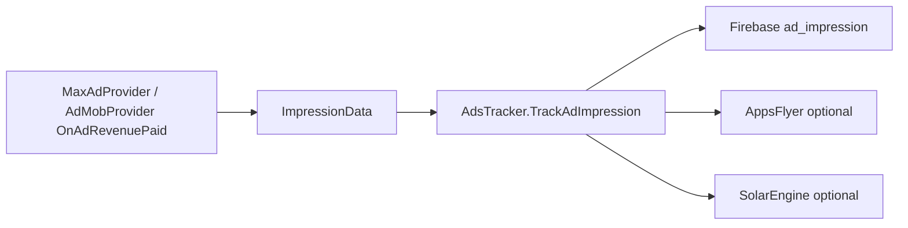

# Thiết kế hệ thống Ads — JIS SDK Ads v6

> Tài liệu mô tả kiến trúc và thiết kế hệ thống quảng cáo trong monorepo **SDK-Ads** (Unity UPM).  
> Cập nhật theo v6 — **JisAds** là entry point duy nhất, chạy trên **Core AdManager**. Legacy runtime đã bị gỡ ([MIGRATION_V6.md](MIGRATION_V6.md)).  
> **Sequential tier (inter/reward):** [TIERED_INTERSTITIAL.md](TIERED_INTERSTITIAL.md)

---

## 1. Tổng quan

### 1.1 Mục đích

**JIS SDK Ads v6** là bộ SDK Unity dùng cho game mobile (Android/iOS), cung cấp:

- Quản lý các định dạng quảng cáo: Banner, Interstitial, Rewarded, App Open (+ Resume ads)
- Mediation qua **AppLovin MAX** hoặc **Google AdMob**
- Tích hợp **Firebase Analytics** và **Remote Config** để điều khiển hành vi ads từ xa
- Tracking doanh thu (impression revenue) và sự kiện ads
- Tùy chọn analytics bên thứ ba (AppsFlyer, SolarEngine, Facebook)

### 1.2 Phạm vi nền tảng

| Nền tảng | Hỗ trợ |
|----------|--------|
| Unity | 2022.3+ |
| Android | Đầy đủ |
| iOS | Đầy đủ |
| Editor | Placeholder / validation (một số format fail có chủ đích) |

### 1.3 Nguyên tắc thiết kế v6

1. **Một entry point** — game chỉ gọi `JisAds.Instance`; không còn lớp Legacy song song
2. **Một mediation chính trên mỗi platform** — ví dụ AdMob trên Android, MAX trên iOS (`JisSDKAdsSettings.singleMediationOnly`)
3. **Provider-agnostic** — `JisAds` điều phối qua `AdManager` (Core) và contract `IAdService`; MAX/AdMob là provider
4. **UPM modular** — mỗi module là package độc lập, cài qua Git UPM + Hub
5. **Firebase là dependency bắt buộc** — `JisAds` init Firebase (và fetch Remote Config nếu bật) trước khi init ads

---

## 2. Kiến trúc tổng thể

### 2.1 Sơ đồ lớp (Layered Architecture)



### 2.2 Phân chia trách nhiệm

| Thành phần | Vai trò | Format xử lý |
|------------|---------|--------------|
| **JisAds** | Entry point duy nhất cho game: init, show/load, capping, level gate, remove ads, consent | Tất cả |
| **Core AdManager** | Orchestrator provider-agnostic: route format → provider, load-on-show, retry | Interstitial, Rewarded, Banner, App Open |
| **AppOpenAdService** | App Open cold start + RC `show_open_ads` | App Open |
| **ResumeAdCoordinator** | Show App Open hoặc Interstitial khi quay lại foreground (theo RC) | Resume |
| **IAdService** | Contract provider (Core) | Init + format interfaces |
| **MaxAdProvider / AdMobProvider** | Adapter tới SDK network, báo revenue cho `AdsTracker` | Theo provider |

Nếu Core không đăng ký được provider nào, hoặc init Core hết lượt retry, `JisAds` tắt routing (`UsesCoreRouting = false`) và không show ads.

---

## 3. Cấu trúc Package UPM

```
Packages/
├── com.jis.sdkads.hub          # Hub import module, scripting defines
├── com.jis.sdkads.core         # AdManager, IAdService, AdEvents, AdFormat
├── com.jis.sdkads.common       # EventManager, Keys (RC), utils
├── com.jis.sdkads.firebase     # FirebaseManager, Analytics, Remote Config
├── com.jis.sdkads.ads          # JisAds, SDKSetup, JisSDKAdsSettings, App Open, Resume, tracking
├── com.jis.sdkads.providers.max    # MaxAdProvider
├── com.jis.sdkads.providers.admob  # AdMobProvider
├── com.jis.sdkads.editor       # Editor tools, build preprocess
├── com.jis.sdkads.iap          # In-app purchasing (remove ads)
├── com.jis.sdkads.analytics.*  # AppsFlyer, SolarEngine, Facebook (optional)
└── com.jis.sdkads.samples      # Sample integration
```

### 3.1 Scripting Defines

| Define | Ý nghĩa |
|--------|---------|
| `UNITY_AD_MAX` | Biên dịch code AppLovin MAX |
| `UNITY_AD_ADMOB` | Biên dịch code Google AdMob |
| `UNITY_APPSFLYER` | Bridge revenue tới AppsFlyer |
| `UNITY_SOLAR_ENGINE` | Bridge impression tới SolarEngine |
| `UNITY_IAP_ACTIVE` | Tích hợp IAP / remove ads |

Hub và **JIS SDK → Ads → Apply Settings to Scene** tự động quản lý các define này.

---

## 4. Loại quảng cáo (Ad Formats)

### 4.1 Bảng format

| Format | Mô tả | Đường xử lý | Mediation |
|--------|-------|-------------|-----------|
| **Banner** | Banner cố định (top/bottom), auto refresh từ RC | Core | MAX / AdMob |
| **Interstitial** | Full-screen giữa các màn | Core | MAX / AdMob |
| **Rewarded** | Video có thưởng | Core | MAX / AdMob |
| **App Open** | Quảng cáo khi mở app | `AppOpenAdService` (Core) | MAX / AdMob |
| **Resume Ads** | Inter hoặc App Open sau background | `ResumeAdCoordinator` | Theo RC `ads_resume_type` |

\* App Open chỉ hoạt động khi provider có unit App Open được cấu hình.

MREC, Collapsible Banner và AdMob Rewarded Interstitial không còn trong v6.

### 4.2 Mediation theo platform

Mediation chọn trong `PlatformAdsProfile.mediation` (MAX hoặc ADMOB) của `JisSDKAdsSettings`. Với Interstitial/Rewarded, RC `fullscreen_mediation_mode` / `interstitial_mediation_mode` / `rewarded_mediation_mode` có thể đổi thứ tự provider khi `singleMediationOnly = false`.

### 4.3 Placement (Rewarded)

- Game truyền chuỗi placement khi gọi `ShowRewardVideo(placement, ...)`
- Placement được ghi vào analytics Firebase (`placement` parameter)

---

## 5. Cấu hình (Configuration)

### 5.1 Asset cấu hình

| Asset | Vị trí | Mục đích |
|-------|--------|----------|
| `JisSDKAdsSettings` | `Assets/JisSDKAds/Settings/` | Profile Android/iOS: mediation + link SDKSetup, init mode, level gate fallback |
| `SDKSetup` | Per-game ScriptableObject | Ad unit IDs, SDK key, tracking flags |
| `MaxAdConfig` / `AdMobConfig` | Trong profile hoặc auto-build | Config provider cho Core |

### 5.2 `JisSDKAdsSettings`

```csharp
public class JisSDKAdsSettings : ScriptableObject
{
    public PlatformAdsProfile android;
    public PlatformAdsProfile ios;
    public AdsInitializationMode adsInitializationMode;  // AutoOnStart / Manual
    public bool singleMediationOnly = true;              // Tắt fallback cross-network
    public int interstitialLevelFallback = 3;            // Level gate khi RC chưa sẵn sàng
}
```

Mỗi `PlatformAdsProfile` chứa:
- `mediation` — MAX hoặc ADMOB
- `sdkSetup` — reference tới `SDKSetup` asset
- `maxProviderConfig` / `admobProviderConfig` — optional, Core provider config

### 5.3 `ProviderConfigFactory`

Nếu `maxProviderConfig` / `admobProviderConfig` trống, runtime tự copy ad unit IDs từ `SDKSetup.maxAdsSetup` / `SDKSetup.admobAdsSetup`.

### 5.4 Scene requirements

Tạo bằng **JIS SDK → Ads → Scene → Add JisSDK Manager Prefab**:

```
JisSDK_Manager
├── Firebase    FirebaseManager, AdsTracker
└── JisAds      JisAds (+ JisSDKAdsSettings), ResumeAdCoordinator
```

| GameObject | Component | Bắt buộc |
|------------|-----------|----------|
| Firebase | `FirebaseManager`, `AdsTracker` | ✅ |
| JisAds | `JisAds` | ✅ |
| JisAds | `ResumeAdCoordinator` | Khi dùng Resume ads |
| Optional | `SdkAdsBootstrap` | Tự thêm `JisAds` |
| Optional | `AdManager` | Core (JisAds tự tạo nếu thiếu) |

Prefab từ SDK < 6.0 còn subtree `Ads_Runtime` với missing script: **JIS SDK → Ads → Scene → Remove legacy Ads_Runtime**.

---

## 6. Luồng khởi tạo (Initialization Flow)

### 6.1 Sequence tổng quát



### 6.2 `JisAds.InitializeAsync(fetchRemoteConfig)`

1. Áp dụng debug settings, đọc trạng thái remove ads từ PlayerPrefs (`key_local_remove_ads`)
2. Warm up SDK MAX / AdMob sớm
3. Init Firebase, fetch Remote Config nếu `fetchRemoteConfig = true`
4. Áp dụng ad inventory / sequential tier từ RC
5. Tạo provider theo profile active, đăng ký vào `AdManager`, gọi `Initialize()`
6. Khi Core sẵn sàng: `IsReady = true`, áp dụng RC banner, bootstrap App Open + Resume, preload format chuẩn

Gọi `InitializeAsync` nhiều lần là an toàn — các lời gọi sau join vào lần init đang chạy. Với `adsInitializationMode = AutoOnStart`, `JisAds` tự init trong `Start`.

### 6.3 Core `AdManager.Initialize()`

1. `JisAds` gọi `ConfigureSingleMediation(providerId, singleMediationOnly)`
2. `ProviderConfigFactory.CreateFromSdkSetup(profile)` → tạo provider
3. `RegisterProvider()` + `Initialize()` tất cả provider đã đăng ký
4. Nếu fail → retry có backoff; hết lượt retry thì `JisAds` tắt routing

---

## 7. Vòng đời Load / Show / Close

### 7.1 Điều kiện show Interstitial

Trước khi show, `JisAds` kiểm tra:

1. `IsRemoveAds` — user đã mua remove ads
2. **Capping** — `inter_capping_from_app_open_seconds`, `inter_capping_between_shows_seconds`, `inter_capping_after_load_fail_seconds` từ RC (bỏ qua với `isSkipCapping`)
3. **Ad loaded** — inventory sẵn sàng (load-on-show nếu chưa)

**Level gate** do game gọi riêng: `JisAds.Instance.IsPassLevelToShowInterstitial(level)` — so với RC `level_show_inter` khi RC sẵn sàng, ngược lại với `JisSDKAdsSettings.interstitialLevelFallback`; không có settings asset thì luôn trả `false`.

### 7.2 Core path (AdManager)

- **Load-on-show:** nếu chưa loaded, tự load trước khi show
- **Retry:** tối đa `maxLoadAttemptsPerProvider` (mặc định 3), delay `retryDelaySeconds` (2s)
- **Cross-provider fallback:** nếu `allowCrossProviderFallback = true`, thử provider dự phòng khi primary fail
- **Events:** static `AdEvents` — loaded, shown, closed, failed, provider init

### 7.3 Watchdog & phục hồi

- Load in-flight hết hạn sau timeout để một SDK không trả lời không chặn reload cả phiên
- Watchdog fullscreen (`fullscreenInFlightWatchdogSec`, mặc định 60s) trả callback nếu SDK không báo close
- Poll network reachability: khi mạng trở lại, fetch lại RC và preload lại
- Banner tự hiện lại sau khi đóng fullscreen ad (`restoreBannerAfterFullscreenAds`)

### 7.4 App lifecycle

`ResumeAdCoordinator` lắng nghe pause/focus và show App Open hoặc Interstitial khi quay lại foreground, theo RC `ads_resume_active`, `ads_resume_type`, `ads_resume_capping_time`, `ads_resume_pause_time`.

### 7.5 Caching model

- **Không có disk cache** — trạng thái "ready" nằm trong memory của SDK network (MAX/AdMob)
- **Preload:** `JisAds` preload sau khi Core sẵn sàng và reload sau mỗi lần đóng ad
- **Remove ads:** `SetRemoveAds(true)` → ẩn banner, chặn interstitial / app open

---

## 8. Mediation & Fallback

### 8.1 Các lớp mediation

| Lớp | Cơ chế | Mô tả |
|-----|--------|-------|
| **Core** | Primary / Fallback provider | Swap giữa MAX ↔ AdMob + retry |
| **Sequential tier** | Tier premium → fill | Nhiều ad unit theo tier cho inter/reward ([TIERED_INTERSTITIAL.md](TIERED_INTERSTITIAL.md)) |
| **AdMob internal** | `AdScheduleUnitID` rotation | Xoay vòng nhiều ad unit ID khi load fail |
| **MAX internal** | AppLovin waterfall | MAX SDK tự quản lý network waterfall |

### 8.2 Core fallback logic

```csharp
// AdManager.TryShowInterstitialWithFallback() (rút gọn)
if (allowCrossProviderFallback && fallback != primary)
    → thử provider dự phòng
else if (attempt < maxLoadAttemptsPerProvider)
    → retry cùng provider
else
    → onFailed
```

**Chính sách mặc định:** `singleMediationOnly = true` → `allowCrossProviderFallback = false` → không swap MAX↔AdMob.

### 8.3 AdMob unit ID rotation

`AdScheduleUnitID` chứa danh sách unit IDs. Khi load fail, `ChangeID()` chuyển sang ID tiếp theo — cơ chế "waterfall" đơn giản ở tầng unit ID.

---

## 9. Remote Config

### 9.1 Bảng key RC chính

| Key constant | RC key | Mục đích |
|--------------|--------|----------|
| `key_remote_interstitial_capping_from_app_open_seconds` | `inter_capping_from_app_open_seconds` | Cooldown interstitial sau App Open (giây) |
| `key_remote_interstitial_capping_between_shows_seconds` | `inter_capping_between_shows_seconds` | Cooldown giữa 2 lần show interstitial |
| `key_remote_interstitial_capping_after_load_fail_seconds` | `inter_capping_after_load_fail_seconds` | Cooldown sau khi load fail |
| `key_remote_interstitial_level` | `level_show_inter` | Level tối thiểu show interstitial |
| `key_remote_aoa_active` | `show_open_ads` | Bật/tắt App Open |
| `key_remote_aoa_show_first_time_active` | `show_open_ads_first_open` | App Open lần đầu mở app |
| `key_remote_ads_resume_ads_active` | `ads_resume_active` | Bật resume ads |
| `key_remote_ads_resume_capping_time` | `ads_resume_capping_time` | Cooldown resume ads |
| `key_remote_ads_resume_pause_time` | `ads_resume_pause_time` | Thời gian pause tối thiểu |
| `key_remote_ads_resume_ads_type` | `ads_resume_type` | INTERSTITIAL hoặc APP_OPEN |
| `key_remote_banner_auto_refresh` | `banner_auto_refresh` | Tự refresh banner |
| `key_remote_banner_auto_refresh_time` | `banner_auto_refresh_time` | Chu kỳ refresh (giây) |
| `key_remote_fullscreen_mediation_mode` | `fullscreen_mediation_mode` | Thứ tự mediation cho inter/reward |
| `key_remote_interstitial_inventory_mode` | `interstitial_inventory_mode` | Single unit hay sequential tier |

`ads_interval` không còn được đọc từ v6. Danh sách đầy đủ: `Packages/com.jis.sdkads.common/Runtime/Config/Keys.cs`.

### 9.2 Luồng cập nhật RC

1. `FirebaseManager.FetchRemoteConfigAsync()` — fetch từ server (trong `InitializeAsync` hoặc `JisAds.FetchAndApplyRemoteConfigAsync()`)
2. `JisAds` áp dụng lại banner refresh, App Open / Resume policy, ad inventory
3. Capping interstitial và level gate đọc RC tại thời điểm show

---

## 10. Analytics & Tracking

### 10.1 `AdsTracker`

Pipeline chính cho tracking ads:



### 10.2 Sự kiện Firebase chính

| Nhóm | Events |
|------|--------|
| **Revenue** | `ad_impression` (+ custom event name từ SDKSetup) |
| **Rewarded** | `ads_reward_click`, `ads_reward_show`, `ads_reward_complete`, `ads_reward_fail`, milestone `ad_rewarded_show_count_N` |
| **Interstitial** | `ad_inter_click`, `ad_inter_show`, `ad_inter_load`, `ad_inter_fail`, milestone `ad_inters_show_count_N` |
| **Local counters** | PlayerPrefs `ad_rewarded_count`, `ad_inters_count` |

### 10.3 Model doanh thu

```csharp
public class ImpressionData
{
    public AdsMediationType ad_mediation;
    public string ad_type;
    public string ad_sourceID;
    public string ad_source;
    public string ad_unit_name;
    public string ad_format;
    public double ad_revenue;
    public string ad_currency;
    public string placement;
}
```

### 10.4 Core events (`AdEvents`)

Static C# events cho lifecycle interstitial/rewarded/banner + provider init — game hoặc tool có thể subscribe.

---

## 11. API cho Game (Host App)

### 11.1 Entry point — `JisAds.Instance`

```csharp
using JisSDKAds.Ads;

// Khởi tạo (tự động trên Start nếu adsInitializationMode = AutoOnStart)
await JisAds.Instance.InitializeAsync(fetchRemoteConfig: true);
await JisAds.Instance.FetchAndApplyRemoteConfigAsync();

JisAds.Instance.ShowInterstitial(
    closedCallback: () => { },
    showSuccessCallback: () => { },
    showFailCallback: () => { },
    isTracking: true,
    isSkipCapping: false);

JisAds.Instance.ShowRewardVideo(
    placement: "double_coin",
    successCallback: () => { },
    closedCallback: closed => { },
    failedCallback: () => { });

JisAds.Instance.ShowBannerAds();
JisAds.Instance.HideBannerAds();
JisAds.Instance.ShowAppOpenAd();

// Level gate, remove ads, consent
JisAds.Instance.IsPassLevelToShowInterstitial(level);
JisAds.Instance.SetRemoveAds(true);
JisAds.Instance.ShowPrivacyOptionsForm();  // MAX CMP hoặc AdMob UMP

// Trạng thái
JisAds.Instance.IsReady;
JisAds.Instance.IsRemoveAds;
JisAds.Instance.IsInterstitialAdLoaded();
JisAds.Instance.CanShowRewardedVideo();

// Truy cập Core
JisAds.Instance.Core;    // AdManager
```

### 11.2 Core provider contract

```csharp
public interface IAdService
{
    string ProviderId { get; }
    bool IsInitialized { get; }
    void Initialize(Action onSuccess, Action<string> onFailure);
    void SetConsent(bool hasConsent);
    IInterstitialAd Interstitial { get; }
    IRewardedAd Rewarded { get; }
    IBannerAd Banner { get; }
    IAppOpenAd AppOpen { get; }
}
```

### 11.3 Migration

- Từ v3/v4: [MIGRATION_V4.md](MIGRATION_V4.md)
- Từ v5 (gỡ legacy runtime): [MIGRATION_V6.md](MIGRATION_V6.md)

---

## 12. Tích hợp Game Project

### 12.1 Các bước cài đặt

1. Thêm `com.jis.sdkads.hub` qua Git UPM ([UPM_INSTALL.md](UPM_INSTALL.md))
2. **JIS SDK → Hub** → Import Firebase, Ads, Enable MAX/AdMob
3. **JIS SDK → Ads → Create/Open Settings Asset** → `JisSDKAdsSettings.asset`
4. Cấu hình `SDKSetup` per platform (ad unit IDs, mediation)
5. Scene: **JIS SDK → Ads → Scene → Add JisSDK Manager Prefab** (Firebase + JisAds)
6. Code: `JisAds.Instance.*`

### 12.2 Integration points

| Điểm tích hợp | Cách dùng |
|---------------|-----------|
| **UPM install** | Git package + Hub import |
| **Settings** | ScriptableObject assets |
| **Scene** | Prefab `JisSDK_Manager` (Firebase + JisAds) |
| **IAP / Remove ads** | `JisAds.Instance.SetRemoveAds(bool)` |
| **Consent** | `JisAds.Instance.ShowPrivacyOptionsForm()` |
| **Remote Config** | Firebase defaults + `FetchAndApplyRemoteConfigAsync()` |
| **Custom events** | Subscribe `AdEvents` (Core) |

### 12.3 Sample

Xem `Packages/com.jis.sdkads.samples/Samples~/MinimalIntegration/README.md`.

---

## 13. Hạn chế & Roadmap

### 13.1 Hạn chế hiện tại

- Firebase **bắt buộc** — `JisAds` init Firebase trước khi init ads
- Không có MREC, Collapsible Banner, Rewarded Interstitial
- Editor: một số format (ví dụ MAX rewarded) fail có chủ đích

### 13.2 Roadmap

1. Mở rộng `IAdService` nếu cần MREC / Collapsible
2. Tách Firebase thành optional abstraction (`IAnalyticsProvider`)

---

## 14. Tài liệu liên quan

| Tài liệu | Nội dung |
|----------|----------|
| [INDEX.md](../INDEX.md) | Project index |
| [GAME_SETUP.md](GAME_SETUP.md) | Hướng dẫn setup game |
| [ADS_USAGE_GUIDE.md](ADS_USAGE_GUIDE.md) | Cách dùng API JisAds |
| [MIGRATION_V6.md](MIGRATION_V6.md) | Migration lên 6.0 (gỡ legacy runtime) |
| [ADS_EDITOR_SETUP.md](ADS_EDITOR_SETUP.md) | Editor setup Ads |
| [IAP_EDITOR_SETUP.md](IAP_EDITOR_SETUP.md) | Editor setup IAP |
| [TIERED_INTERSTITIAL.md](TIERED_INTERSTITIAL.md) | Sequential tier inter/reward |
| [NAMESPACES.md](NAMESPACES.md) | Namespace mapping |
| [UPM_INSTALL.md](UPM_INSTALL.md) | Cài UPM packages |

---

## 15. File tham chiếu quan trọng

| Chủ đề | Đường dẫn |
|--------|-----------|
| Entry point | `Packages/com.jis.sdkads.ads/Runtime/JisAds.cs` |
| Core orchestrator | `Packages/com.jis.sdkads.core/Runtime/AdManager.cs` |
| App Open | `Packages/com.jis.sdkads.ads/Runtime/Ads/AppOpen/AppOpenAdService.cs` |
| Resume ads | `Packages/com.jis.sdkads.ads/Runtime/Ads/Resume/ResumeAdCoordinator.cs` |
| Format config | `Packages/com.jis.sdkads.ads/Runtime/Ads/SDKSetup/SDKSetup.cs` |
| Platform settings | `Packages/com.jis.sdkads.ads/Runtime/Settings/JisSDKAdsSettings.cs` |
| Consent form | `Packages/com.jis.sdkads.ads/Runtime/Integration/ConsentFormBridge.cs` |
| Tracking | `Packages/com.jis.sdkads.ads/Runtime/Analystic/AdsTracker.cs` |
| RC keys | `Packages/com.jis.sdkads.common/Runtime/Config/Keys.cs` |
| Provider interface | `Packages/com.jis.sdkads.core/Runtime/Interfaces/IAdService.cs` |

---

*Tài liệu cập nhật theo codebase SDK-Ads v6 — tháng 10/2026.*
