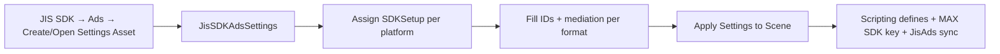

# Ads Editor Setup — JIS SDK v6

> Luồng cấu hình ads trong Editor: **một nguồn sự thật** (`JisSDKAdsSettings`), platform rõ ràng, format bật/tắt qua mediation.  
> Từ 6.0 runtime legacy đã bị gỡ — scene chỉ còn **Firebase + JisAds** ([MIGRATION_V6.md](MIGRATION_V6.md)).

---

## Single source of truth: `JisSDKAdsSettings`

Tạo bằng **JIS SDK → Ads → Create/Open Settings Asset** → `Assets/JisSDKAds/Settings/JisSDKAdsSettings.asset`
(kèm `AndroidSDKSetup.asset` / `IOSSDKSetup.asset` cùng thư mục).

```
JisSDKAdsSettings.asset
├── android: PlatformAdsProfile
│   ├── mediation (MAX | ADMOB)
│   ├── sdkSetup → AndroidSDKSetup.asset
│   ├── maxProviderConfig / admobProviderConfig (Core, optional)
│   └── SequentialTierConfig (trong SDKSetup / AdMob)
├── ios: PlatformAdsProfile
│   └── (tương tự)
├── adsInitializationMode (Manual | AutoOnStart)
├── singleMediationOnly
└── interstitialLevelFallback (level gate khi RC chưa sẵn sàng)
```

### Bật/tắt ad format

Trong từng `SDKSetup`, mỗi format có field `xxxAdsMediationType`:

| Giá trị | Ý nghĩa |
|---------|---------|
| `NONE` | Format **tắt** — không init, không load |
| `MAX` | Format dùng AppLovin MAX |
| `ADMOB` | Format dùng Google AdMob |

Inspector `JisSDKAdsSettings` hiển thị **overview** từng platform (✓ / —) theo `AdsSetupUtility`.

### Platform

- **Editor preview:** toolbar Android | iOS trên `JisSDKAdsSettings` inspector
- **Apply to Scene:** áp profile theo **active build target** hiện tại
- **Runtime:** `GetActiveProfile()` theo `Application.platform`

---

## Luồng Editor



### Menu chính (`JIS SDK`)

```
JIS SDK/
├── Hub
├── Ads/
│   ├── Create/Open Settings Asset
│   ├── Apply Settings to Scene
│   ├── Scene/
│   │   ├── Add JisSDK Manager Prefab
│   │   └── Remove legacy Ads_Runtime      ← dọn prefab từ SDK < 6.0
│   └── Auto Apply/
│       ├── Toggle On Platform Switch
│       ├── Toggle On Play
│       ├── Toggle On Build
│       └── Apply Now (Active Build Target)
├── IAP/                              ← tách riêng khỏi Ads
│   ├── Enable IAP
│   ├── Create/Open Packages Config
│   ├── Validate Packages Config
│   └── Scene/
│       └── Add JisSDK InApp Purchaser Prefab
└── (Hub import IAP module trước — menu IAP cần UNITY_IAP_ACTIVE)

GameObject/JIS SDK/
├── Ads/
│   └── Add JisSDK Manager
└── IAP/
    ├── Enable IAP
    └── Add JisSDK InApp Purchaser
```

Đường dẫn menu nằm trong `Editor/JisSDKMenuPaths.cs`.

### Inspector `JisSDKAdsSettings`

- **Apply to Scene (active platform)** — chạy `JisSDKAdsSettingsApplier.Apply` (xem bên dưới)
- **Validate** — thiếu SDKSetup, mediation NONE, không format nào active, tiered thiếu fallback ID, scripting define thiếu / thừa
- **Platform toolbar** — xem overview + inline SDKSetup (Single / Sequential tier)

---

## Apply pipeline (`JisSDKAdsSettingsApplier.Apply`)

1. `ApplyRuntimeDebugSettings()` — debug logging
2. `SyncAllProfileMediationToSdkSetups()` — `profile.mediation` → `SDKSetup.adsMediationType`
3. `ApplyScriptingDefinesForAllPlatforms()` — `UNITY_AD_MAX` / `UNITY_AD_ADMOB` cho Android và iOS
4. Khởi tạo default inventory (single / sequential tier) cho các SDKSetup
5. `SDKSetup.SyncMaxSdkKeyToAppLovinSettings()` — copy MAX SDK key sang AppLovin settings (idempotent)
6. `SyncJisAdsInScene()` — gán `JisAds.settings` và đồng bộ `autoInitializeOnStart` theo `adsInitializationMode`

**Auto Apply** (mặc định bật cả 3) gọi cùng pipeline khi switch platform, khi Play (chỉ khi scene có `JisAds`) và khi build.

---

## Scene

**JIS SDK → Ads → Scene → Add JisSDK Manager Prefab** dựng hierarchy và lưu prefab vào `Assets/JisSDKAds/Prefabs/` lần đầu:

```
JisSDK_Manager
├── Firebase    FirebaseManager, AdsTracker
└── JisAds      JisAds (+ JisSDKAdsSettings), ResumeAdCoordinator
```

Nếu scene đã có manager cũ còn subtree `Ads_Runtime`, menu này hỏi có gỡ không; hoặc chạy
**JIS SDK → Ads → Scene → Remove legacy Ads_Runtime** trên prefab / scene object.

---

## Checklist setup game mới

1. **JIS SDK → Ads → Create/Open Settings Asset**
2. Chọn `JisSDKAdsSettings` → tab Android / iOS
3. Mỗi platform: chọn **primary mediation**
4. Trong SDKSetup: set mediation từng format + ad unit IDs
5. Cấu hình inter/reward: **Single unit** hoặc **Tiered** (Sequential ladder) + Firebase RC ([TIERED_INTERSTITIAL.md](TIERED_INTERSTITIAL.md))
6. Scene: **JIS SDK → Ads → Scene → Add JisSDK Manager Prefab**
7. **Apply Settings to Scene** (hoặc nút trên inspector)
8. Code: `JisAds.Instance.*` ([ADS_USAGE_GUIDE.md](ADS_USAGE_GUIDE.md))
9. Play / Build — auto apply nếu bật

---

## File tham chiếu

| File | Vai trò |
|------|---------|
| `Settings/JisSDKAdsSettings.cs` | Root config asset |
| `Settings/PlatformAdsProfile.cs` | Per-platform profile |
| `Settings/AdsSetupUtility.cs` | Format active status |
| `Editor/Settings/JisSDKAdsSettingsEditor.cs` | Unified inspector |
| `Editor/Settings/JisSDKAdsSettingsApplier.cs` | Apply + validate |
| `Editor/Settings/JisSDKAdsSettingsMenu.cs` | Create / Apply menu |
| `Editor/BuildHandler/JisAdsAutoPlatformSetup.cs` | Auto Apply |
| `Editor/JisSDKSceneSetupBuilder.cs` | Dựng `JisSDK_Manager`, gỡ legacy `Ads_Runtime` |
| `Editor/JisSDKMenuPaths.cs` | Đường dẫn menu |
